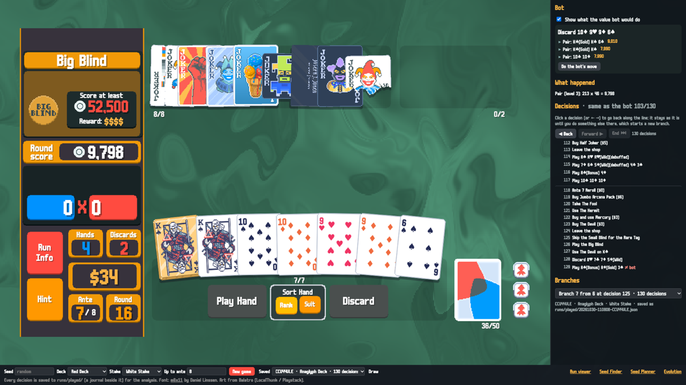
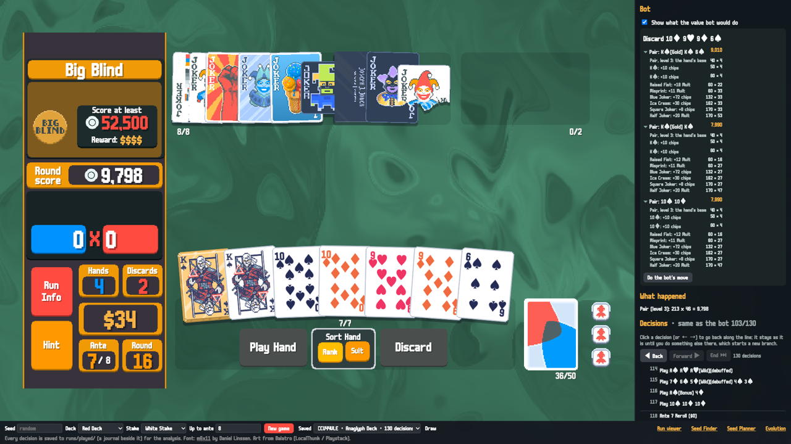
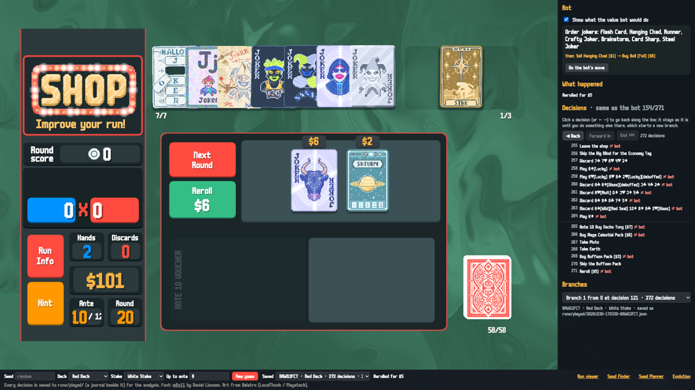
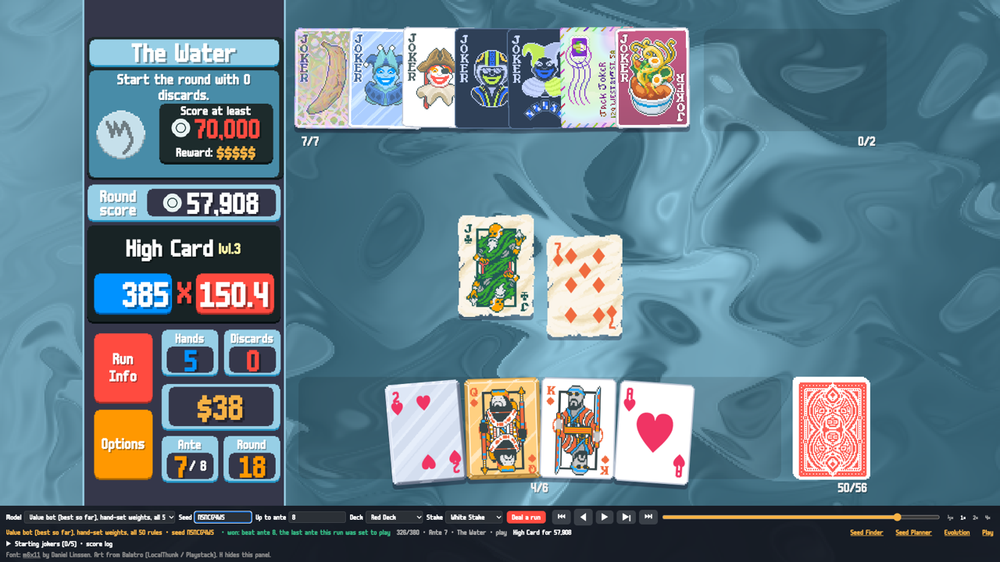
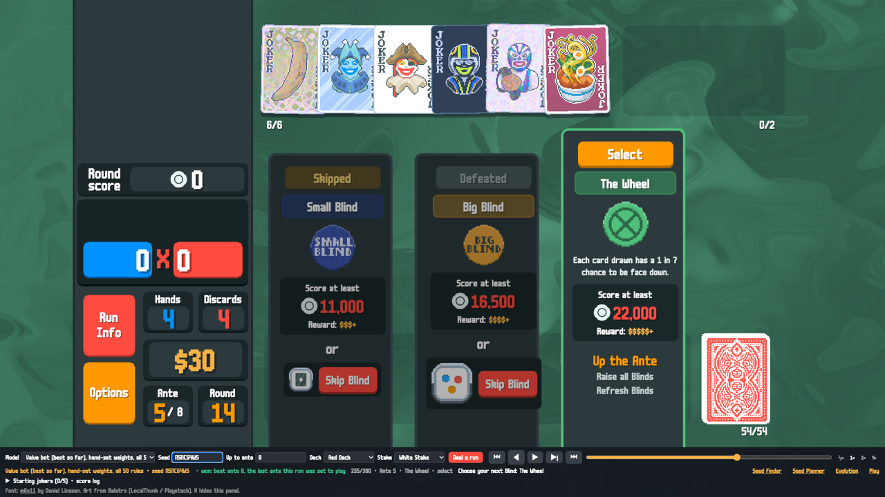
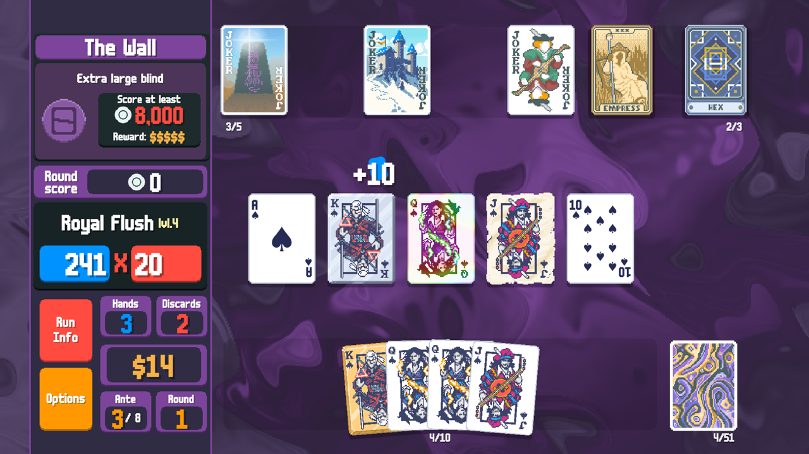
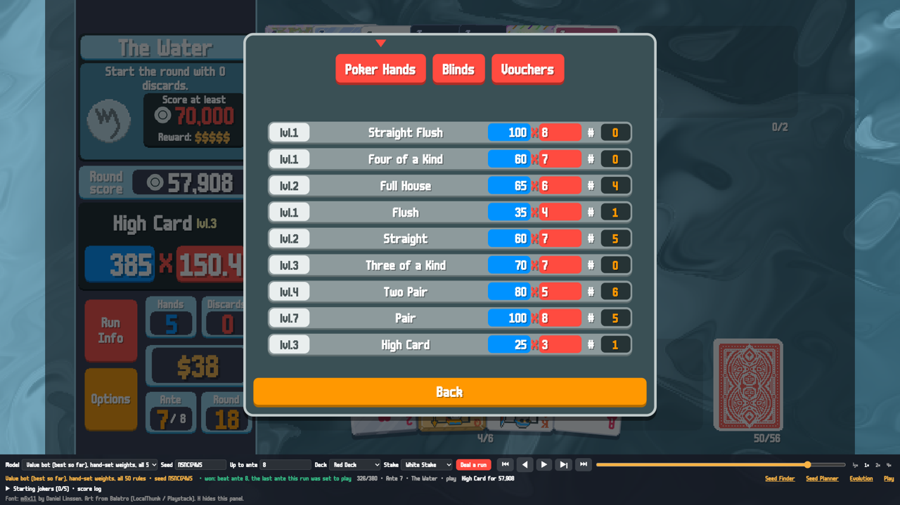
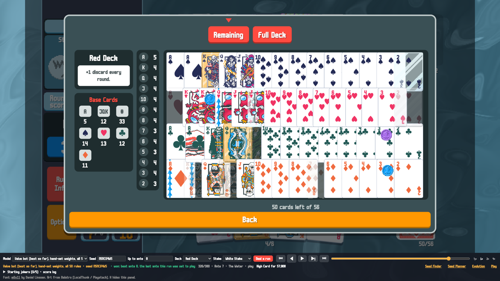
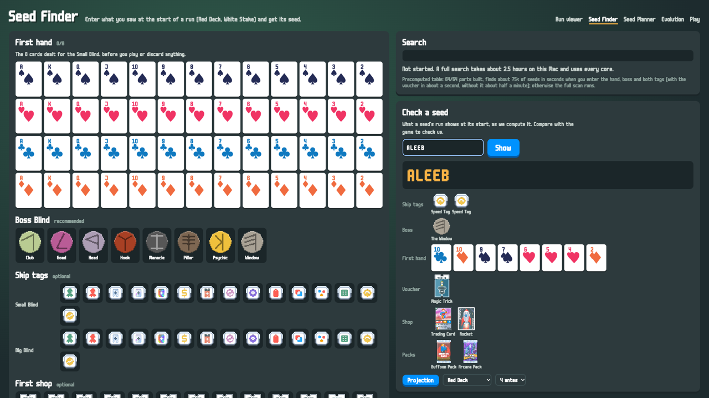
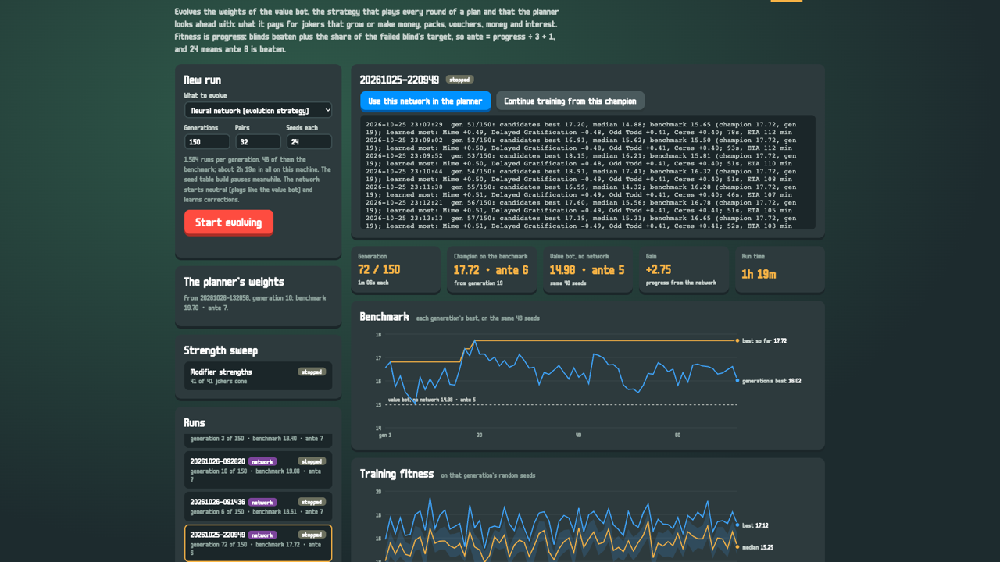

# Balatro Lab

A Balatro simulator, a bot that beats ante 8 in **70% of runs**, and a browser app where you can play the game
yourself with the bot as your advisor, or watch it play.



| | |
|---|---|
| Win rate (beat ante 8, Red Deck, White Stake) | **70.2%** and **72.5%** on two sets of 480 fresh seeds |
| Where it started, five days earlier | 8.5% (a rule-based bot) |
| What the bot sees | only what a player sees: no deck order, no face-down cards, no future rolls |
| Dependencies | none (Python 3.11+, standard library); pytest for the tests |

## What's inside

- **A simulator of nearly the whole game.** All 150 jokers, 22 Tarots, 12 Planets, 18 Spectrals, 28 bosses, 24 tags,
  32 vouchers, 15 decks and 8 stakes, with editions, enhancements, seals, the shop, booster packs and the scoring
  order (retriggers, held cards, Blueprint chains). Given a game seed it follows the game's own random streams for
  the deck order, bosses, tags, shops, rerolls and pack contents, so a seed plays out as it does in the game.
  758 tests.
- **The value bot,** a hand-written player that weighs every purchase, pick and play (below).
- **Balatro Lab in the browser,** drawn with the game's art and animations:
  - **Play:** play a run yourself. "Show what the value bot would do" gives the bot's move at every decision,
    with the worth of each option and what it's made of. Every game is saved, every decision can be replayed as a
    new branch, and your moves are compared with the bot's. `play.html#game=<id>&hint=1` opens a saved game with
    the bot's advice showing.
  - **Run viewer:** watch any bot play any seed, step by step.
  - **Seed Planner:** the best line a search finds for one seed.
  - **Seed Finder:** find a seed from the cards of a run's first hand (a C scanner over every seed).
  - **Evolution:** evolve the bot's weights and pick a champion.

## Screenshots

<table>
<tr>
<td width="50%"><br>
<sub><b>Play:</b> the bot's candidate plays, each scored joker by joker</sub></td>
<td width="50%"><br>
<sub><b>Play:</b> a shop at ante 10; the bot would reorder its jokers, then sell Hanging Chad for a Foil Bull</sub></td>
</tr>
<tr>
<td><br>
<sub><b>Run viewer:</b> the bot scoring a hand at The Water, ante 7, with seven jokers</sub></td>
<td><br>
<sub><b>Run viewer:</b> choosing the next blind, with the skip tags and the boss</sub></td>
</tr>
<tr>
<td><br>
<sub>A Royal Flush scoring at The Wall, effect by effect, as the game animates it</sub></td>
<td><br>
<sub><b>Run Info:</b> hand levels and how often each was played</sub></td>
</tr>
<tr>
<td><br>
<sub><b>Deck view:</b> the cards left to draw, with enhancements, editions and seals</sub></td>
<td><br>
<sub><b>Seed Finder:</b> pick a run's first hand to find its seed, or check what a seed's run opens with</sub></td>
</tr>
<tr>
<td><br>
<sub><b>Evolution:</b> evolving the bot's weights, its benchmark and training fitness by generation</sub></td>
<td></td>
</tr>
</table>

## Quick start

```bash
python3 app/server.py          # open http://127.0.0.1:8643  (Play tab: play.html)
python3 -m pip install pytest
python3 -m pytest              # the test suite
```

The Seed Finder needs its C scanner compiled once (macOS or Linux, any C compiler):

```bash
cc -O3 -ffp-contract=off -o seedfinder/fastcheck seedfinder/fastcheck.c -lpthread
```

A search scans every seed: about two hours on 18 cores. (`seedfinder/table.c` can build a 10 GB lookup table that
answers in seconds; see `seedfinder/REPORT.md`.)

Measure the bot yourself (480 seeds; about an hour on 16 cores, the look-ahead included):

```bash
python3 -u scripts/eval_value.py --bot base --label mine --rng 90210
python3 scripts/compare_evals.py <baseline label> mine     # seed by seed against another run
```

## How well it plays

Each line is the reference version at that point, measured on the same 480 seeds (set 90210):

| Date | Beat ante 8 | What changed |
|---|---|---|
| 26 Oct | 8.5% | a rule-based bot, the starting point |
| 26 Oct | 19.6% | the value bot's rule set switched on |
| 27 Oct | 39.6% | jokers that grow valued by what they will grow to |
| 27 Oct | 53.8% | money: hold the interest reserve, spend beyond it, weigh rerolls |
| 29 Oct | 56.5% | every option of a decision weighed on the same sample hands |
| 30 Oct | 64.8% | fixes found in human play: Flash Card, Lucky cards |
| 30 Oct | 65.8% | Glass and other enhanced cards seen in the play ranking |
| 31 Oct | **70.2%** | a look-ahead in boss rounds (72.5% on the second seed set) |

**How it's measured.** Every change is played on 480 fresh seeds and compared seed by seed with the version before
it, so luck largely cancels out. A judgment call stays off until it wins on that set and again on a second set of
480 seeds. Plain bugs are fixed and switched on at once. `scripts/probe_leaks.py` replays every decision with the
hidden things changed (deck order, face-down cards, future rolls) and must find no difference: the bot may not peek.

## How the bot thinks

- **Power.** The bot deals 12 sample hands from its deck and scores the best play in each with its jokers, levels
  and cards. The build's power is the average log of those scores.
- **Shop and packs.** A joker, Planet, Tarot or sale is worth the change it makes to power, plus weights for what
  today's hands can't show (jokers that grow, money, packs, vouchers), against the price and the interest it costs.
  Random effects are tried on copies of the run with their own random streams.
- **Rounds.** It plays its best hand unless a discard is likely to lead to a better one, drawing from the cards it
  knows are left (never their order). In boss rounds it looks ahead: before each play or discard, its own choice and
  the leading alternatives are each played out to the end of the round many times on reshuffled unseen cards, and
  it takes the one that wins most often.
- **Bosses and skips.** It sees the ante's boss and plays to it (The Mouth, The Eye, Verdant Leaf...), and skips a
  blind for its tag only when its typical hand beats the next target with room to spare.

## What we learned

- **83% of lost runs end at a boss.** Violet Vessel (ante 8, six times the usual target), The Wall, The Needle,
  Crimson Heart, The Eye and The Water end two to three times as many runs as the other bosses.
- **The biggest single gain was round play, not shopping.** Replaying the bot's lost boss rounds with the same cards,
  a look-ahead player won about a third of them. Half of what it changed was playing a hand that was already good enough
  instead of discarding it. Built into the bot, it added +4.4 and +2.3 points on the two seed sets.
- **People find the bot's mistakes.** Several gains came from a human player asking "why did it do that?" in the
  Play tab and the answer being a valuation bug.
- **Some plausible ideas did nothing.** Valuing shop items by the odds of surviving the next blind, projecting the
  build to ante 8, and digging with discards when behind all measured within noise.
- **The jokers that win.** Runs holding Vampire, Bootstraps, Constellation, Cavendish, Hologram or Stuntman at ante 5
  won about 90% of the time, against 70% on average; runs leaning on flat or shrinking jokers (Popcorn, Smiley Face,
  Fibonacci, Bull) won 40-55%. That's correlation, not proof.

## Layout

| Path | What |
|---|---|
| `balatro/run.py` | A run: antes, blinds, rounds, shop, money |
| `balatro/scoring.py`, `hands.py`, `cards.py` | Poker hands and scoring in the game's order |
| `balatro/content/` | Every joker, consumable, boss, tag, voucher and deck |
| `balatro/gameseed.py` | The game's random streams for a given seed |
| `balatro/strategy.py` | The value bot |
| `balatro/search.py` | The look-ahead used in boss rounds |
| `balatro/planner.py` | The Seed Planner's search |
| `balatro/interactive.py` | The Play tab: games as recorded actions, replayed to the next decision, with branches |
| `app/` | The browser app (`server.py` and the pages in `app/static/`) |
| `scripts/` | Evaluation, comparison, leak checks, fork tests, decision mining |
| `data/` | The rules data, with sources |
| `seedfinder/` | The Seed Finder's C scanner and notes |
| `BACKLOG.md` | What's being measured and what comes next, with the evidence |

## Rules data

The rules come from the community [Balatro wiki](https://balatrowiki.org): numbers are copied, descriptions are
paraphrased. Sources are listed in `data/SOURCES.md`; conflicts and assumptions in `data/OPEN_QUESTIONS.md`.

## Try it and help

Play a few runs in the Play tab with the bot's advice on. When it suggests something that looks wrong, open an issue:
many of the bot's biggest gains came from exactly that. Measurements on your machine, simulator fixes and bot
improvements are all welcome; [CONTRIBUTING.md](CONTRIBUTING.md) says how, and how a change is measured.

## Credits

Balatro is made by LocalThunk and published by Playstack. This is an unofficial fan project, not affiliated with
either. The card art is from the game. The font is [m6x11](https://managore.itch.io/m6x11) by Daniel Linssen.

## License

The code is under the [MIT License](LICENSE). Balatro's name and art belong to their owners.
